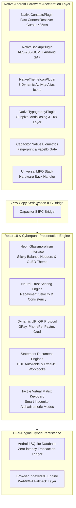

<div align="center">

# 💎 ABHI'S LEDGER // THE FINANCIAL MAINFRAME
### *Next-Generation Offline-First Debt Intelligence & Credit Ledger*

[](https://github.com/Abhi10112006/Ledger-/releases)
[](LICENSE)
[](https://ledger69.vercel.app/)
[](https://www.typescriptlang.org/)
[](https://react.dev/)
[](https://capacitorjs.com/)
[](utils/cryptoBackup.ts)
[](#-zero-cloud-privacy-guarantee)

<br/>

**[🌐 Launch Web Mainframe](https://ledger69.vercel.app/)** • **[📦 Download APK](https://github.com/Abhi10112006/Ledger-/releases)** • **[🛠️ Installation Guide](INSTALLATION.md)** • **[🗺️ Migration Plan](MIGRATION_IMPLEMENTATION_PLAN.md)**

---

</div>

## 💀 Kill The Spreadsheet. Bury The Notebook.

Most personal finance and debt tracker apps are slow, cluttered with ads, and insist on uploading your private contacts and financial dealings to third-party cloud servers. 

**Abhi's Ledger** is engineered differently. Built as a high-fidelity **Cyberpunk Debt Intelligence System**, it combines a lightning-fast offline-first engine with military-grade device-only encryption, a proprietary **Neural Trust Scoring Algorithm**, instant **UPI settlement protocols**, and high-performance native Android hardware acceleration.

> **No accounts. No telemetry. No third-party servers. No subscription paywalls.**  
> Your financial data lives exclusively in your hands.

---

## ⚔️ The Ledger Advantage: Why We Win

| Feature | ❌ The "Other" Apps | 📉 Spreadsheets & Notes | 💎 Abhi's Ledger v3.0 |
| :--- | :--- | :--- | :--- |
| **Data Privacy** | Cloud servers, data mining | Plain text, unencrypted | **100% On-Device (SQLite & IndexedDB)** |
| **Authentication** | Passwords stored on web servers | None | **Biometric Gate (Fingerprint/Face) + Salted PIN** |
| **Settlement** | Manual text reminders | Manual copy-pasting | **Instant Dynamic UPI QR Codes + Shareable Cards** |
| **Borrower Analysis** | None | Manual math | **Neural Trust Score Engine (0–100 scale)** |
| **Backup Security** | Plaintext JSON / CSV | Plain files | **Hardware-backed AES-256-GCM + Android SAF** |
| **Contacts Query** | Web form / Slow slow import | Manual entry | **Sub-35ms Native Cursor Projection** |
| **Launcher Dynamic Icons** | Static app icon | N/A | **8 Dynamic Activity-Alias Themes (No restart)** |
| **Statements** | Clunky screenshots | Raw CSV dumps | **Pixel-Perfect Branded PDF & Multi-Sheet XLSX** |
| **Back Navigation** | App closes accidentally | N/A | **Universal LIFO Multi-Modal Back Stack** |
| **Design Language** | Generic white & blue SaaS UI | Gray grids | **OLED True Black, Cyberpunk Neons & Glass** |

---

## 🏛️ System Architecture

Abhi's Ledger runs on a hybrid high-performance architecture bridging native Android hardware APIs with a reactive TypeScript presentation matrix:



---

## ⚡ Core Arsenal & Feature Suite

### 1. 🧠 The Neural Trust Engine
Stop guessing whether a peer or client is good for repayment. The proprietary algorithmic trust engine continuously scores profiles on an integrity scale of **0 to 100**:
*   **🛡️ Elite Tier (90–100):** Consistently settles on or before due date. High transaction reliability.
*   **🟢 Prime Tier (75–89):** Reliable borrower with minimal lateness frequency.
*   **⚠️ High Risk Tier (25–74):** Prolonged overdue balances, partial payments, irregular velocity.
*   **💀 Critical Alert (0–24):** Severely delinquent. System actively warns against further lending.

### 2. 💳 Dynamic UPI Settlement Protocol
Settle debts in seconds without copy-pasting bank accounts or UPI IDs:
*   **Instant Dynamic QR Generation:** Generates real-time, zero-error UPI QR codes embedding the exact balance, payee name, and payment note.
*   **Universal App Compatibility:** Works seamlessly with **Google Pay, PhonePe, Paytm, BHIM, Cred, and Navi**.
*   **Shareable Digital Debt Slips:** Renders crisp, branded WhatsApp debt summary cards ready to dispatch with one click.

### 3. 🔒 Biometric Security Shield & Cryptographic PIN
*   **Hardware Biometrics:** Native Android BiometricPrompt integration unlocks your financial vault with Fingerprint or Face ID.
*   **Salted Hardware PIN Fallback:** 6-digit cryptographic PIN verification backed by salted SHA-256 hashing.
*   **Auto-Lock System:** Automatic session termination when switching apps or locking the device.

### 4. 🛡️ Military-Grade Encrypted Backups
*   **AES-256-GCM Authenticated Encryption:** Backups are shielded using industry-standard Galois/Counter Mode authenticated encryption.
*   **Storage Access Framework (SAF):** Full native Android SAF integration writes `.ledger` backup files directly to user-designated local folders or external drives without granting the app invasive broad filesystem permissions.
*   **Zero Cloud Leakage:** No server uploads, no sync telemetry. Your financial records never leave your control.

### 5. 👥 Sub-35ms Native Contacts Engine
*   **Optimized Cursor Projection:** Custom Android plugin queries `ContactsContract.CommonDataKinds.Phone` using high-speed projection cursors in under $35\text{ ms}$.
*   **Cyberpunk Glass Picker:** Browse your address book with instant search, avatar resolution, and frictionless account creation.

### 6. 🎨 8 Dynamic Launcher Themes (Live Icon Swapping)
*   **Zero-Restart Theme Engine:** Switch between 8 themes (**Amber, Aurora, Blue, Carbon, Emerald, Rose, Tokyo, Violet**) with instantaneous Android `<activity-alias>` dynamic icon updates via `DONT_KILL_APP` flag.

### 7. 📄 Pixel-Perfect PDF & Excel Statement Generator
*   **Professional PDF Statements:** Clean, print-ready account statements formatted with the signature "L" emblem, transaction chronologies, overdue markers, and settlement summaries.
*   **Multi-Sheet Excel Workbooks:** Formatted `.xlsx` accounting spreadsheets generated on-device with calculated totals, deal dates, and interest breakdowns using `ExcelJS`.

### 8. ⌨️ Tactile Virtual Matrix Keyboard & Multi-Language
*   **Custom In-App Virtual Keyboard:** Complete keyboard isolation prevents external keyboard learning, autocorrect leaks, or keylogging.
*   **Haptic Engine:** Tactile touch feedback and sound cues on every numerical entry.
*   **10+ Global Languages:** Fully localized in English, Hindi (हिंदी), Spanish (Español), French (Français), German (Deutsch), Russian (Русский), Japanese (日本語), Chinese (中文), Arabic (العربية), and Portuguese (Português).

---

## 🛠️ Tech Stack & Specifications

| Layer | Technologies |
| :--- | :--- |
| **Frontend Framework** | React 18.2, TypeScript 5.8, Vite 6.2 |
| **Mobile Runtime** | Capacitor 8.0, Android SDK Platform 34/35, Gradle 8.11 / 9.4 |
| **Styling & Effects** | Tailwind CSS 3.4, Framer Motion, Lucide Icons, Custom Fonts |
| **Persistence** | SQLite Native (`@capacitor-community/sqlite`), IndexedDB (`idb`) |
| **Cryptography & Security** | AES-256-GCM, Salted SHA-256, Android BiometricPrompt |
| **Document Generators** | jsPDF, jsPDF-AutoTable, ExcelJS, HTML5 Canvas |
| **Hardware Plugins** | Custom Java Native Plugins: Contacts, Backup SAF, Theme Icons, Typography |

---

## 🚀 Quick Start Guide

### 1. Web Local Run
```bash
# Clone the repository
git clone https://github.com/Abhi10112006/Ledger-.git
cd Ledger-

# Install dependencies
npm install

# Start Vite development server
npm run dev
```
Visit `http://localhost:5173/` in your browser.

### 2. Android Mobile Build
```bash
# Build production web bundle
npm run build

# Sync assets and plugins to Android project
npx cap sync android

# Open project in Android Studio
npx cap open android
```
*For detailed setup instructions, including signing release APKs and configuring environment variables, read the **[Installation & Deployment Guide](INSTALLATION.md)**.*

---

## 🗺️ Migration & Engineering Roadmap

Abhi's Ledger is actively evolving along a 4-phase engineering roadmap:

- [x] **Phase 1: Native Acceleration Baseline**
  - Native Android Contacts cursor engine ($<35\text{ ms}$).
  - Encrypted local backups using Android Storage Access Framework (SAF).
  - High-fidelity PDF export engine with overdue day counter.
- [x] **Phase 2: Mobile Security & Visual Engine**
  - Native Biometric unlock (Fingerprint / Face ID).
  - 8 Dynamic launcher icon activity-aliases without app reload.
  - Hardware typography acceleration & Universal LIFO back stack.
- [ ] **Phase 3: High-Performance Relational SQLite (In Progress)**
  - Full relational Room/SQLite schema with normalized tables.
  - Native `WorkManager` & `AlarmManager` for reboot-proof due date notifications.
  - Android Keystore integration for hardware-bound encryption keys.
- [ ] **Phase 4: Ecosystem & Platform Expansion**
  - Android Home Screen Glance Quick Widgets.
  - Jetpack Compose hybrid screens for 120 FPS infinite contact scrolling.
  - P2P encrypted Bluetooth / WiFi Direct local offline device sync.

*Track full technical details in [`MIGRATION_IMPLEMENTATION_PLAN.md`](MIGRATION_IMPLEMENTATION_PLAN.md).*

---

## 🔐 Zero-Cloud Privacy Guarantee

1. **No External Servers:** Ledger operates without a backend database. All ledger entries, contact names, and notes reside solely within your device's encrypted storage.
2. **Zero Telemetry or Analytics:** No third-party trackers, no crash loggers, no behavioral cookies.
3. **Hardware Storage Access Framework (SAF):** Backups are written strictly where you choose; the app never asks for blanket device storage access.
4. **Verifiable Source Code:** Inspect every line of code directly in this repository.

---

## 🤝 Contributing

Contributions are welcome! If you'd like to improve the app or implement a roadmap item:
1. Fork the Project (`https://github.com/Abhi10112006/Ledger-`)
2. Create your Feature Branch (`git checkout -b feature/AmazingFeature`)
3. Commit your Changes (`git commit -m 'feat: Add AmazingFeature'`)
4. Push to the Branch (`git push origin feature/AmazingFeature`)
5. Open a Pull Request

---

## 📄 License & Architect

Distributed under the **MIT License**. See [`LICENSE`](LICENSE) for details.

**Architect & Lead Developer:**  
👤 **Priyanshu Kumar (Abhi10112006)**  
📧 Contact: [abhiyaduvanshi@zohomail.in](mailto:abhiyaduvanshi@zohomail.in)  
🌐 GitHub: [@Abhi10112006](https://github.com/Abhi10112006)

---

<div align="center">
<sub>Designed and engineered for financial sovereignty. Built with ⚡ in 2026.</sub>
</div>
