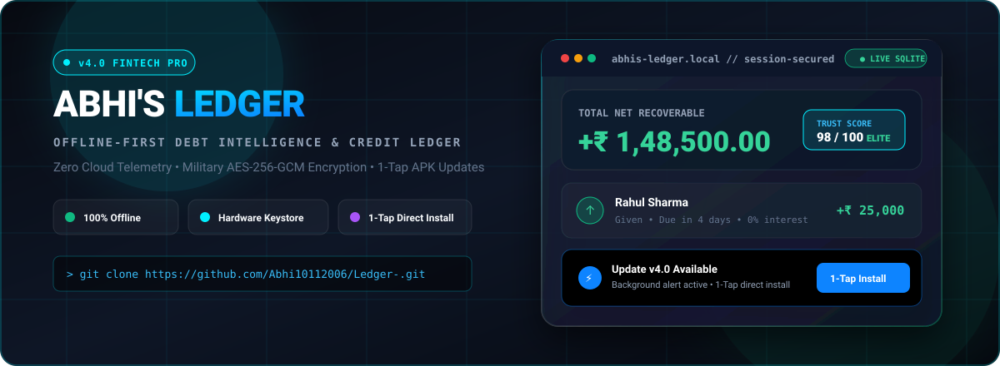
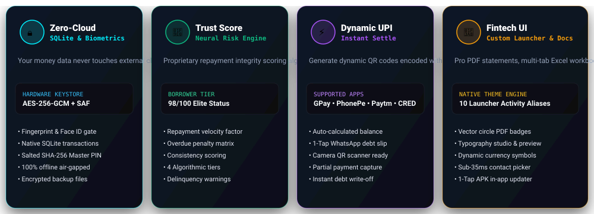
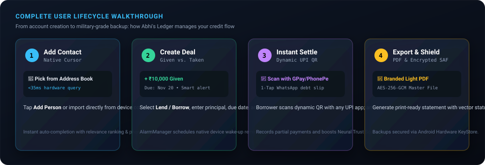
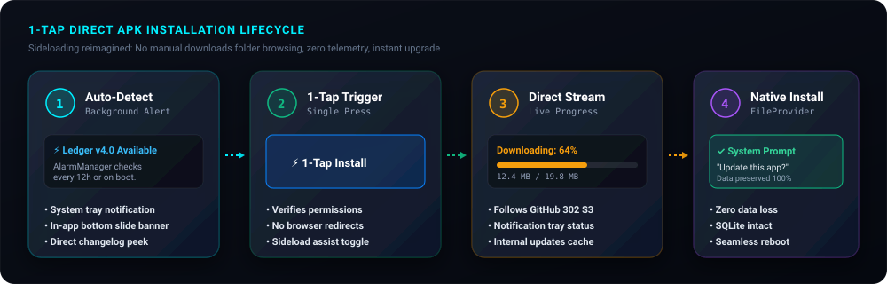
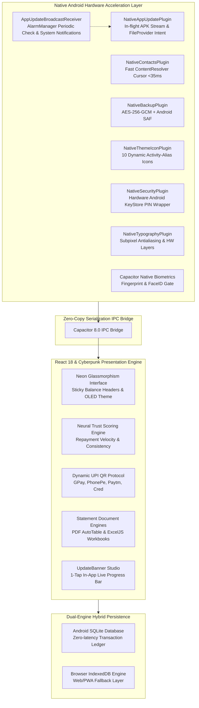

<div align="center">

# 💎 ABHI'S LEDGER // THE FINANCIAL MAINFRAME
### *Next-Generation Offline-First Debt Intelligence & Credit Ledger*

[](https://github.com/Abhi10112006/Ledger-/releases)
[](LICENSE)
[](https://ledger69.vercel.app/)
[](https://www.typescriptlang.org/)
[](https://react.dev/)
[](https://capacitorjs.com/)
[](utils/cryptoBackup.ts)
[](#-zero-cloud-privacy-guarantee)

<br/>

<p align="center">
  <a href="https://github.com/Abhi10112006/Ledger-/releases/latest/download/app-release.apk">
    
  </a>
  &nbsp;&nbsp;
  <a href="https://ledger69.vercel.app/">
    
  </a>
</p>

<br/>



<br/>

**[📦 Direct APK Download](https://github.com/Abhi10112006/Ledger-/releases/latest/download/app-release.apk)** • **[🌐 Web PWA](https://ledger69.vercel.app/)** • **[📖 Step-by-Step App Guide](#-step-by-step-guide-how-to-use-abhis-ledger)** • **[📲 1-Tap APK Install Guide](#-step-by-step-apk-download--installation-guide)** • **[🛠️ Installation Manual](INSTALLATION.md)**

---

</div>

## 💀 Kill The Spreadsheet. Bury The Notebook.

Most personal finance and debt tracker apps are sluggish, riddled with ads, and insist on uploading your private contacts, transactions, and financial records to third-party cloud servers. 

**Abhi's Ledger** is engineered differently. Built as a high-fidelity **Cyberpunk Debt Intelligence System**, it combines a lightning-fast offline-first engine with military-grade device-only encryption, a proprietary **Neural Trust Scoring Algorithm**, instant **Dynamic UPI settlement protocols**, **1-Tap in-app sideload updates**, and high-performance native Android hardware acceleration.

> **No accounts. No telemetry. No third-party servers. No subscription paywalls.**  
> Your financial data lives exclusively on your physical hardware.

---

## 🏛️ Feature Matrix: Why Abhi's Ledger Wins



| Capability | ❌ The "Other" Apps | 📉 Spreadsheets & Notes | 💎 Abhi's Ledger v3.5 |
| :--- | :--- | :--- | :--- |
| **Data Privacy** | Cloud servers, data mining | Plain text, unencrypted | **100% On-Device (SQLite & IndexedDB)** |
| **Authentication** | Passwords stored on web servers | None | **Biometric Gate (Fingerprint/Face) + Hardware Keystore PIN** |
| **In-App Updating** | App Store lock-in or manual download | None | **1-Tap Direct Sideload Download & System Package Installer** |
| **Background Alerts** | Cloud push trackers (Firebase) | None | **Native Android AlarmManager Background Receivers** |
| **Settlement** | Manual text reminders | Manual copy-pasting | **Instant Dynamic UPI QR Codes + WhatsApp Debt Slips** |
| **Borrower Analysis** | None | Manual math | **Neural Trust Score Engine (0–100 scale)** |
| **Backup Security** | Plaintext JSON / CSV | Plain files | **Hardware-backed AES-256-GCM + Android SAF** |
| **Contacts Query** | Slow web forms / manual import | Manual typing | **Sub-35ms Native Cursor Projection** |
| **Launcher Dynamic Icons** | Static app icon | N/A | **10 Dynamic Activity-Alias Themes (No restart)** |
| **Statements** | Clunky screenshots | Raw CSV dumps | **Pixel-Perfect Branded PDF (Vector Badges) & Multi-Sheet XLSX** |
| **Back Navigation** | App closes accidentally | N/A | **Universal LIFO Multi-Modal Back Stack** |
| **Design Language** | Generic white & blue SaaS UI | Gray grids | **OLED True Black, Cyberpunk Neons & Glass** |

---

## 📖 Step-by-Step Guide: How to Use Abhi's Ledger



### Step 1: First-Time Setup & Biometric Shield
1. **Launch the App**: When you open Abhi's Ledger for the first time, you are greeted by the interactive **Mascot Matrix** and setup screen.
2. **Enter Your Name**: Personalize your ledger workspace.
3. **Set Up Master Security**:
   * Create a **6-Digit Master Security PIN** (hashed and secured via Android Hardware KeyStore).
   * Toggle on **Biometric Authentication** (Fingerprint / Face ID) to unlock the app in $<100\text{ ms}$.
4. **Choose Your Base Currency**: Select your currency from ₹ (INR), $ (USD), € (EUR), £ (GBP), ¥ (JPY), ₩ (KRW), ₿ (BTC), or custom symbols in **Settings**.

---

### Step 2: Adding Accounts & Native Contact Import
1. Tap the **`+ Add Person`** button on the bottom navigation bar or dashboard.
2. **Option A — 1-Tap Device Contact Import (Android)**:
   * Tap the **Address Book** icon.
   * Android's native hardware `ContentResolver` queries your contacts in **$<35\text{ ms}$**.
   * Search by name or phone number with real-time relevance matching and select any contact to auto-populate their profile.
3. **Option B — Manual Entry**:
   * Type in the name, phone number, and optional relationship notes.
4. Tap **Save Account**. Your new debtor/creditor profile is instantly initialized in the SQLite database.

---

### Step 3: Recording Deals & Credit Transactions
1. Open an account profile and tap **`+ New Deal`** (or tap **`Quick Deal`** from the dashboard).
2. **Choose the Transaction Direction**:
   * **Given (Lend / Asset)**: Money you gave to the person (they owe you).
   * **Taken (Borrow / Liability)**: Money you borrowed from the person (you owe them).
3. **Fill Deal Parameters**:
   * **Amount**: Enter the principal sum using the tactile virtual or system keyboard.
   * **Date**: Defaults to today, or select any past date.
   * **Due Date**: Select when the debt is scheduled to be settled.
   * **Interest Rate (Optional)**: Choose between 0% interest or specify monthly/annual rates.
   * **Remarks / Purpose**: Add tags like `Travel Split`, `Inventory Advance`, `Personal Loan`.
4. Tap **Confirm Deal**. The app automatically schedules a native Android due-date alarm via `DebtReminderBroadcastReceiver`.

---

### Step 4: Tracking Repayments & Neural Trust Score
1. **Record a Repayment**:
   * Open the deal card and tap **Record Payment**.
   * Input full or partial repayment amount.
   * The app recalculates the remaining balance in real time and moves fully settled deals to the **Settled History** archive.
2. **The Neural Trust Score (0–100 Engine)**:
   * As transactions and settlements occur, the proprietary algorithmic engine analyzes **repayment velocity**, **due-date punctuality**, and **overdue duration**:
     * 🛡️ **Elite Tier (90–100)**: Consistently settles on or before due date. High transaction reliability.
     * 🟢 **Prime Tier (75–89)**: Reliable borrower with minimal lateness frequency.
     * ⚠️ **High Risk Tier (25–74)**: Prolonged overdue balances, partial payments, irregular velocity.
     * 💀 **Critical Alert (0–24)**: Severely delinquent. The system actively warns against further lending.

---

### Step 5: Dynamic UPI QR Code Settlement & WhatsApp Slips
1. Open any outstanding deal with an Indian UPI contact.
2. Tap the **UPI / QR Code** button.
3. **Dynamic QR Generation**:
   * The system automatically generates a compliant dynamic UPI QR code encoded with:
     * Recipient UPI ID (`vpa`)
     * Payee Name
     * Exact Remaining Debt Balance (`am`)
     * Transaction Note (`tn`)
4. **Instant Payment**:
   * The other person scans the screen with **Google Pay, PhonePe, Paytm, CRED, or BHIM**. The amount is auto-locked so neither party makes a typo.
5. **1-Tap WhatsApp Debt Slip**:
   * Tap **Share to WhatsApp** to generate a pre-formatted, polite debt summary breakdown ready to send in 1 tap.

---

### Step 6: Exporting Professional PDF & Excel Statements
1. Inside any profile, tap **Export Statement**.
2. **Branded Light-Paper PDF Statement**:
   * Engineered with clean typography, account summary headers, total interest, and vector circle status badges (`● Paid`, `● Overdue`, `● Pending`) that print cleanly without ink-heavy dark backgrounds.
3. **Multi-Sheet Excel Workbook (`.xlsx`)**:
   * Formatted using `ExcelJS` with auto-calculated formula cells, summary headers, deal logs, and repayment history tables.
4. Save directly to Android device storage via the **Storage Access Framework (SAF)** or share instantly via Android Sharesheet.

---

### Step 7: Customizing Themes, Launcher Icons & Typography
1. Open **Settings** (Gear icon on top-right):
2. **Dynamic Launcher Icons (Android Native)**:
   * Select from **10 Custom Cyberpunk Themes**: *Emerald, Violet, Blue, Rose, Amber, Platinum, Tokyo, Crimson, Aurora, Carbon*.
   * Uses Android `<activity-alias>` and `PackageManager.DONT_KILL_APP` to dynamically switch your home screen app icon instantly without killing the app.
3. **Typography Studio**:
   * Select from 4 hand-picked typefaces:
     * `Inter` (Fintech High-Legibility Sans)
     * `JetBrains Mono` (Cyberpunk Developer Terminal)
     * `Special Elite` (Classic Typewriter Ledger)
     * `Comic Neue` (Casual Friendly)
   * Real-time preview specimen card displaying your active currency symbol.

---

### Step 8: Military-Grade Hardware Encrypted Backups
1. Open **Settings** → **Backup & Security**.
2. Tap **Create Encrypted Backup**:
   * The app generates an AES-256-GCM encrypted `.ledger` container protected by Android Hardware KeyStore.
   * No plain text data leaves the device.
3. **Restore**:
   * To restore on a new phone or after a wipe, tap **Restore Backup**, pick your `.ledger` file, and enter your master secret. Your entire SQLite database is reconstructed in milliseconds.

---

## 📲 Step-by-Step APK Download & Installation Guide



Abhi's Ledger is an independent, sovereign Android application distributed outside Google Play Store to protect your data privacy. We have made installing and updating as seamless as an app store:

---

### Method A: 1-Tap Direct In-App Upgrade (Existing Users)

If you already have Abhi's Ledger installed on your device:
1. **Background Discovery**:
   * The native Android `AppUpdateBroadcastReceiver` checks [`public/version.json`](https://raw.githubusercontent.com/Abhi10112006/Ledger-/main/public/version.json) every 12 hours and on device reboot.
2. **System Tray Notification**:
   * A system notification appears in your status bar:  
     `⚡ Ledger Update: v3.5 Available — Tap to install directly!`
3. **1-Tap Direct Install**:
   * Tap the notification or open the app to see the bottom update banner.
   * Tap **`⚡ 1-Tap Direct Install`**.
   * The app streams the APK in the background with a live progress bar.
   * Android's native package installer dialog pops up immediately:  
     *"Do you want to install an update to this application?"*
   * Tap **Install** — your database, accounts, and active deals are **100% preserved**!

---

### Method B: Fresh Install from GitHub Releases (New Users)

#### Step 1: Download the Latest APK
Download the verified APK directly from the official repository release:

👉 **[Download Latest APK (v3.5.0)](https://github.com/Abhi10112006/Ledger-/releases/latest/download/app-release.apk)**  
*(Alternative: Browse all historical releases at [GitHub Releases](https://github.com/Abhi10112006/Ledger-/releases))*

#### Step 2: Open the Downloaded APK
* When the download completes, tap the notification in your browser or open your device **Files / Downloads** app and tap **`app-release.apk`**.

#### Step 3: Allow Installation from This Source (First-Time Android Sideload)
Android protects against unauthorized APK installations. If prompted:
1. Tap **Settings** on the prompt dialog (*"For your security, your phone is not allowed to install unknown apps from this source"*).
2. Toggle **ON** **"Allow from this source"** for your browser (Chrome/Firefox/Brave) or File Manager.
3. Tap the **Back** button.
4. Tap **Install**.

#### Step 4: Launch & Lock
* Tap **Open**. Enter your name, set your 6-digit Master PIN and Fingerprint, and start tracking your wealth with zero cloud surveillance!

---

## 🚀 How to Publish Releases (For Maintainers)

When you make improvements and want all existing users to automatically receive the update:
1. **Increment Version**:
   * Bump `"version"` in [`public/version.json`](public/version.json) (e.g. `"3.5.0"` → `"3.6.0"`).
   * Update `"changelog"` in [`public/version.json`](public/version.json).
   * Bump `APP_VERSION` in [`utils/version.ts`](utils/version.ts).
   * Increment `versionCode` (e.g. `4` → `5`) and `versionName` in [`android/app/build.gradle`](android/app/build.gradle).
2. **Build Release APK**:
   ```bash
   npm run build
   npx cap sync android
   cd android && .\gradlew.bat assembleRelease
   ```
3. **Publish on GitHub**:
   * Create a new Release tagged `v3.6.0` on [GitHub Releases](https://github.com/Abhi10112006/Ledger-/releases).
   * Attach the compiled file named **`app-release.apk`**.
   * Hit **Publish**.
4. **Done!** Every user's device will detect the new version within 12 hours, receive a system tray notification, and upgrade in 1 tap!

---

## 🏗️ System Architecture & Native Plugins



---

## 🛠️ Developer Installation & Compilation

To build and run Abhi's Ledger locally on your workstation:

### 1. Clone & Install Dependencies
```bash
git clone https://github.com/Abhi10112006/Ledger-.git
cd Ledger-
npm install
```

### 2. Run Web Development Server
```bash
npm run dev
```
Open [http://localhost:5173](http://localhost:5173) in your browser.

### 3. Build & Compile Android APK
```bash
# Build React web bundle
npm run build

# Sync assets to native Android project
npx cap sync android

# Open in Android Studio
npx cap open android
```
*(Or compile headless via Gradle: `cd android && .\gradlew.bat assembleDebug`)*

For in-depth troubleshooting, keystore generation, and signing manuals, consult the **[Official Installation Guide](INSTALLATION.md)**.

---

## 🛡️ Zero-Cloud Privacy Guarantee

Abhi's Ledger operates under a strict **Zero-Knowledge, Zero-Cloud Protocol**:
1. **No External Databases**: There is no Firebase, Supabase, AWS, or central server collecting your financial profiles or transaction notes.
2. **No Analytics or Trackers**: No Google Analytics, Mixpanel, Sentry, or advertising SDKs.
3. **No Account Requirement**: No email, phone verification, or passwords stored on a web server.
4. **Air-Gapped Operation**: Turn on Airplane Mode. Every single feature — from adding deals to computing Trust Scores and exporting PDFs — functions flawlessly offline.

---

## 📄 License & Intellectual Property

Distributed under the **MIT License**. See [`LICENSE`](LICENSE) for full details.

Developed with 💎 by **Abhinav** ([@Abhi10112006](https://github.com/Abhi10112006)). Contributions, feature requests, and bug reports are welcome via [GitHub Issues](https://github.com/Abhi10112006/Ledger-/issues).
